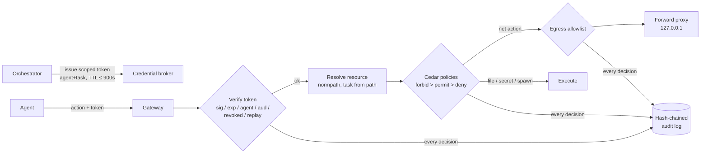

# agent-sandbox

A sandbox gateway for AI agents. It gives each agent and task its own scoped, short-lived credentials, sends all network traffic through an egress allowlist proxy, and checks every action against Cedar-syntax policies. Each decision goes to an append-only, hash-chained audit log. An escape/escalation suite of 35 attacks and 11 legitimate actions measures what gets blocked.

## What it is
- **Credential broker** (`credentials.py`): HMAC-SHA256 signed tokens (stdlib, JWT-like) bound to `agent`, `task`, `scopes`, `audience`. Default TTL 300 s, hard cap 900 s. Supports one-time tokens, revocation when a task ends, and delegation where a child token gets a subset of the parent's scopes and can't outlive it. The signing key is generated at runtime and never written to disk.
- **Egress allowlist + proxy** (`egress.py`): origin matching on (scheme, host, port) after normalisation. A real threaded HTTP forward proxy (GET/POST/CONNECT) enforces it, and denied requests never resolve DNS.
- **Policy engine** (`cedar.py` + [`policies/sandbox.cedar`](policies/sandbox.cedar)): a pure-Python interpreter for a **subset** of the Cedar language. It uses Cedar's decision rule: forbid wins, then permit, otherwise default deny, and a policy that hits an evaluation error is skipped.
- **Audit log** (`audit.py`): JSON Lines file. Each entry stores the SHA-256 of the previous one. The API only appends and verifies.
- **Gateway** (`gateway.py`): credential → resource resolution (path normalisation) → Cedar → egress → audit, for every action.

## Why
An agent with ambient credentials and open egress turns a single prompt injection into a full breach. The fix is the same least-privilege stack used for services: credentials that expire and are tied to one task, a short list of places data can go, an explicit policy for every action, and a log the agent can't rewrite.

## Architecture


## How it works
Policy summary (`policies/sandbox.cedar`):

| Action | Rule |
|---|---|
| `file_read` / `file_write` | permit only if the file's task equals the token's task and the token has `fs:read` / `fs:write` |
| `http_get` / `http_post` | permit with `net:egress`; the proxy still enforces the host allowlist |
| `http_post` | forbid to hosts tagged `file_share` even if allowlisted (paste sites) |
| `secret_read` | permit only the task's own secrets with `secret:read` |
| `spawn_agent` | permit with `agent:spawn` and child scopes ⊆ parent scopes |
| `policy_update`, `credential_issue` | forbid for all agents |
| write/delete `*/.audit*` | forbid for everyone |

The egress checker blocks: hosts that aren't listed, suffix tricks (`api.github.com.evil.example`), userinfo tricks (`api.github.com@evil.example`), IP literals including decimal/hex forms and cloud metadata IPs, port changes, scheme downgrade, non-HTTP schemes, wildcard apex, and non-ASCII (homoglyph) hosts.

## Results
Run: `python evals/run_eval.py`. Raw output in [`results/results.json`](results/results.json). All attempts are synthetic and run against the local gateway.

| Category | Attempts | Blocked | Notes |
|---|---|---|---|
| Exfiltration (egress) | 14 | **13/14** | the miss is the documented known-gap case |
| Credential misuse | 10 | **10/10** | expired, TTL cap, stolen by another agent, forged scope, forged task, garbage, replay, wrong audience, revoked after task end, unknown agent |
| Scope creep | 8 | **8/8** | write with read-only token, other task's file/secret, `../` traversal, outside workspace, broader spawn |
| Privilege escalation | 3 | **3/3** | policy update, credential issue, audit-log write |
| **All attacks** | **35** | **34/35 (0.971)** | |
| Legitimate actions | 11 | **11/11 allowed** | 0 false blocks |

Where the blocks happened: credential 10, Cedar policy 13, egress 11.

Audit log: 46 entries, chain valid after the run. Tamper detection on copies of the log: edited decision **detected**, deleted line **detected**, reordered lines **detected**, truncated middle **detected** (4/4).

**Known gap (counted as a miss):** `GET https://api.github.com/search?q=db_pw%3Dhunter2` is allowed. An allowlist controls *where* data goes, not *what* goes, so data can be smuggled through query strings, headers or bodies to any allowlisted host. That needs content inspection or taint tracking (see `taint-tracking-agent`).

## Tests
28 offline tests (`pytest`): Cedar default deny, when/unless, forbid-overrides-permit, entity hierarchy, `like` semantics, error skipping, parse errors; token round trip, expiry, TTL cap, delegation limits, revocation; 11 allowlist cases; a **real proxy test** (local upstream on 127.0.0.1, allowed GET returns upstream body, unlisted host gets 403 with no DNS); audit tamper detection and reload; suite size and full-suite outcomes.

```bash
pip install pytest
python -m pytest -q
python evals/run_eval.py
```

## Limits / threat model
- **Cedar subset, not the official engine.** No schema validation, no `ip`/`decimal` extensions, no templates, no arithmetic. Policies are written in Cedar syntax so they can move to `cedar-policy` later, but they have not been checked against the official engine.
- **The gateway is in-process.** A real deployment runs agents in a separate OS sandbox (container/VM, seccomp, no direct network), so the proxy is the only route out. Here the only guarantee is that actions go through `Sandbox.request`.
- **DNS rebinding and redirects are not handled.** The proxy connects to the hostname it was given and does not pin resolved IPs or re-check redirect targets.
- **HMAC tokens use one shared key in the broker process.** Production would use asymmetric keys (so verifiers can't mint) and key rotation.
- **Audit log is tamper-evident, not tamper-proof.** Someone with file access can rewrite the whole chain. Anchor the head hash externally (WORM storage, a transparency log) to fix this.
- Content exfiltration to allowlisted hosts (see Results).

## Stack
Python 3.10+ · stdlib only · pytest

## License
MIT
